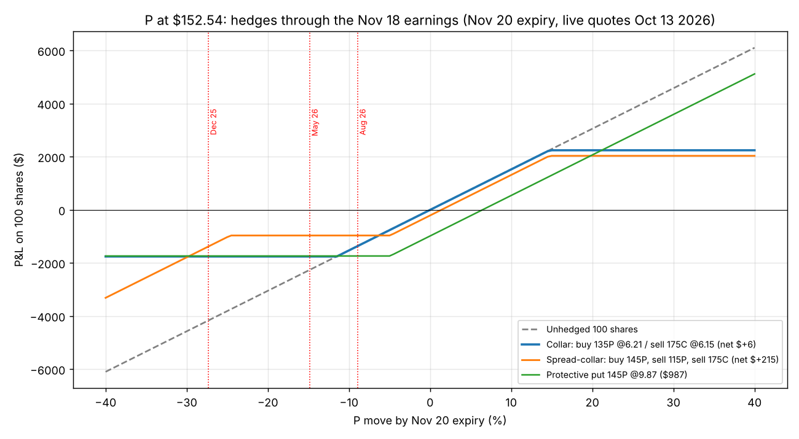

# Shock protection for momentum positions: collars on stocks like P

Question: the trend positions earn their return by sitting through weeks of overnight gaps, but the
same exposure means an earnings report or a sector shock can gap through any stop (P: -27%, -15%,
-9% on its last three reports). Can an options overlay cap that without giving up the trend?

Short answer: **yes, but only a collar, only around the known event, and only on positions of at
least 100 shares.** Protective puts alone are too expensive at this volatility, and a standing
collar caps exactly the upside the trend book is there to capture.

All prices below are real Alpaca option quotes: the live Nov 20 2026 and Jan 15 2027 chains pulled
on Oct 13 2026, and historical daily option bars for the three past reports (PSTG root before the
April 2026 ticker change, P root after). Scripts: `research/options_live.py`, `options_hist.py`,
tool: `earnings_collar.py`.

## 1. What a hedge would have done on P's three earnings shocks

Hedge placed at the close of the session before the report, 100 shares, valued at the reaction-day
close. Puts bought at the close price, calls sold at the close price (`research/out/options_hist_dayminus1.log`).

| Report | Stock move | Unhedged | Put 10% OTM only | Collar: put -10% / call +11-16% | Collar net cost |
|---|---|---|---|---|---|
| Dec 3 2025 (Q3 FY26) | **-27.3%** | -$2,587 | -13.4% (put cost 3.2%, paid $1,620) | **-9.9% to -11.0%** | -0.4% to +0.7% |
| May 28 2026 (Q1 FY27) | **-14.8%** | -$1,270 | -12.8% (put cost 4.2%) | **-6.9% to -8.2%** | -2.4% to -0.9% (credit) |
| Aug 27 2026 (Q2 FY27) | **-8.9%** | -$966 | -7.8% (put cost 5.1%) | **-3.3% to -4.3%** | -0.2% to +1.1% |

Three things the replay shows:

- **The put alone barely helps.** At 60-80% implied volatility a 10%-OTM put costs 3 to 5% of the
  position for a few weeks. On the -27% day it recovered half the loss; on the -15% and -9% days it
  recovered almost nothing, because implied volatility collapsed after the report and the put's
  time value went with it.
- **The collar works because the call pays for the put.** Selling a call 11 to 16% above the price
  brought in as much as the put cost. Net cost ran from a 2.4% credit to a 1.1% debit, and the loss
  was cut by half to two thirds on every event.
- **Timing matters.** The same hedges placed five sessions early (`research/out/options_hist.log`)
  did worse: in May 2026 the stock rose 10% into the report, so a put bought a week early at -10%
  was 17% out of the money when the drop came and lost money. Place the collar at the close before
  the report, not earlier.

## 2. What it costs today: P at $152.54, Nov 18 report, Nov 20 expiry (live chain, Oct 13 2026)

P has monthly options only (Oct 16, Nov 20, Jan 15), so the Nov 20 expiry is the first after the
report. Implied volatility is about 70%.

| Structure (per 100 shares = $15,254) | Cost | Worst case to expiry | Upside cap |
|---|---|---|---|
| Collar: buy 135P (-11%) @ 6.21, sell 175C (+15%) @ 6.15 | **+$6 (0.0%)** | **-11.5%** | +14.7% |
| Collar: buy 135P, sell 170C (+11%) | -$140 credit | -10.6% | +12.4% |
| Collar: buy 145P (-5%), sell 175C | +$372 (2.4%) | -7.4% | +12.3% |
| Spread-collar: buy 145P, sell 115P (-25%), sell 175C | +$215 (1.4%) | -6.4% down to -25%, then unprotected | +13.6% |
| Protective put 145P (-5%) alone | +$987 (6.5%) | -11.4% | none |
| Protective put 135P (-11%) alone | +$621 (4.1%) | -15.6% | none |



The zero-cost collar at roughly -11% / +15% is the structure. It turns the three historical shocks
(-27%, -15%, -9%) into about -11%, -11% and -9% worst cases, for nothing, in exchange for giving up
anything above +15% until Nov 20. For a 94-day Jan 2027 collar the numbers are similar
(135P/175C is a 0.5% credit), but see the caveat below on why not to run it for 94 days.

## 3. The rules

1. **Hedge the event, not the position.** A standing collar caps the trend. P rose 58% in the two
   months to Oct 9; a Jan collar sold at +15% would have surrendered most of that. The EMA21 trail
   and the -8% disaster stop handle ordinary days; options handle the one day a stop cannot.
2. **Collar, never a naked put.** At 60-80% IV a put is 4 to 7% of the position per month and gets
   crushed by the post-report volatility drop. Finance it with a call 11 to 16% above spot. Aim for
   net cost between a 1% credit and a 1% debit.
3. **Strikes:** put 8 to 11% below spot (just inside the stock's typical earnings move, which for P
   is about 15%), call at whatever strike makes the collar free, usually +11 to +16%.
   Both legs in the first expiry on or after the reaction day.
4. **Timing:** put it on at the close of the session before the report. Take it off the morning
   after: sell the put for its intrinsic value if the stock gapped down (and let the EMA21 rule
   decide the stock), buy back the call if the stock gapped up and the position is to be kept.
5. **Lot size is the hard constraint.** A collar is 100 shares. On the RDT real book a 10% slot is
   $1,500 to $3,500, 10 to 25 shares of P, so a one-lot collar would hedge 4x to 10x the position.
   Below 100 shares the rule stays mechanical: exit at the close before the report (or cut to half)
   and re-enter on the post-earnings breakout. The paper book at $35k is in the same position.
   Only a trend slot of ~$15k+ in a $150 stock can be collared one for one.
6. **Small-account alternative:** replace the shares with one call of 0.35 to 0.45 delta into the
   report (about 35 to 45 shares of exposure, max loss the premium, roughly 4 to 6% of notional).
   This keeps upside through the report, which the collar does not, at the price of the premium.
7. **Non-earnings shocks** (sector or macro) are not hedgeable at a sensible price on a single
   70%-vol name. Use the -8% stop and position count. If protection is wanted at book level,
   a put spread on the sector ETF is the cheaper instrument; that is a separate study.

## 4. The tool

`trading/earnings_collar.py` prices the structures on the live chain and can place the collar on the
paper account as one two-leg order:

```
python trading/earnings_collar.py P --shares 100 --earnings 2026-11-18          # price it
python trading/earnings_collar.py P --shares 100 --earnings 2026-11-18 --paper  # place the collar (paper)
python trading/earnings_collar.py P --unwind --paper                             # close the option legs after the report
```

Output on Oct 13 (`research/out/earnings_collar_P.log`): put 140 (-8%) ask 8.13, call 175 (+14%)
bid 6.24, collar +$189 (1.2%), worst case -9.7%, cap +13.2%; spread-collar with the 115 put sold
costs $31. With 23 shares it refuses the collar and prints the exit-before-earnings recommendation.
Order placement is written against Alpaca's multi-leg order API and has not yet been exercised live.

## 5. For the RDT engine

The engine already has a Hedge Desk and a Collar Strategy doc. The addition is an event rule on the
trend-hold strategy (see `P_EVERPURE_DEEP_DIVE.md` section 6):

- at the close before a report inside the hold: if shares ≥ 100, submit the collar (put -10%, call at
  the strike that makes it free, first expiry after the report); else exit or halve.
- the morning after: unwind the option legs; the EMA21 exit rule then applies to the stock as usual.
- config keys: `hedge_min_shares=100`, `hedge_put_pct=0.10`, `hedge_max_net_cost_pct=0.01`,
  `hedge_small_position_action='exit'|'half'|'call_replace'`.
- earnings dates come from the Polygon earnings feed the scanner already uses.

Not financial advice. Three events on one stock plus one live chain.

## Files
- `earnings_collar.py`: pricing and paper placement tool
- `research/options_live.py`, `research/out/options_live.log`, `research/out/P_chain_2026-11-20.csv`, `P_chain_2027-01-15.csv`
- `research/options_hist.py`, `research/out/options_hist.log` (hedge 5 days early), `options_hist_dayminus1.log` (day before), `P_earnings_hedge_dayminus1.csv`
- `P_collar_payoff.png`
