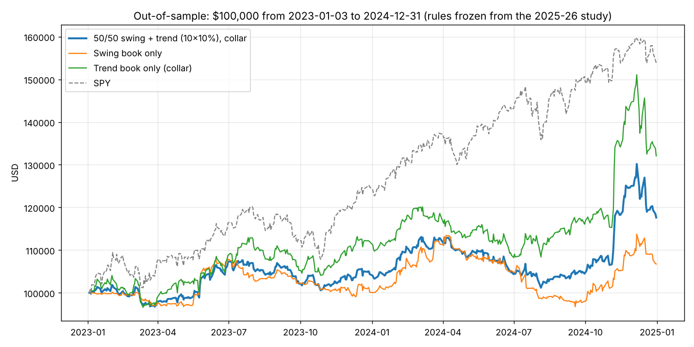

# Out-of-sample test on 2023-2024: what held up, what did not

Rules frozen from the 2025-26 study, nothing re-tuned. New data: daily bars from Jan 2022, Stage 1
leaders for all 502 sessions of 2023-24, 5-minute bars for the 461 names that made the list.
$100k, 5 bps slippage per side. Scripts: `research/oos_2324.py`, `research/oos_checks.py`;
logs: `research/out/oos2324.log`, `oos_checks_2324.log`, `oos_checks_2526.log`.

SPY did +54% in 2023-24 (vs +33% in 2025-26). It was a strong, broad bull market with a choppy
first half of 2023 and a sharp October 2023 low.

## 1. Per-trade edge, all four years

| Book | 2023 | 2024 | 2025 (in-sample) | 2026 YTD |
|---|---|---|---|---|
| Swing: trades / PF / avg R | 202 / 1.16 / +0.04 | 320 / 1.22 / +0.07 | 221 / 1.63 / +0.21 | 194 / 1.95 / +0.36 |
| Trend: trades / PF / avg return | 697 / 1.31 / +0.75% | 1,030 / 2.01 / +2.21% | 709 / 1.35 / +1.01% | 562 / 1.46 / +1.44% |

- **The trend book's edge is real and stable.** Profit factor above 1.3 in every one of the four
  years, including two years it never saw. Average hold about 30 days, win rate 39 to 47%.
- **The swing book's edge is regime-dependent.** It was marginal in 2023-24 (PF 1.2, quarters
  alternating between +20R and -10R) and strong in 2025-26 (PF 1.8). It did not lose money in
  2023-24, but +7% over two years on $100k is not worth the activity. Its 2025-26 result was partly
  the 2026 chip and memory theme.

## 2. Portfolio results on 2023-24, as the plan currently stands

| $100k, 10 slots x 10% per book | 2023-24 total | CAGR | Max DD | Sharpe |
|---|---|---|---|---|
| SPY | +54% | +24% | -10% | 1.75 |
| Swing book only | +7% | +3% | -15% | 0.38 |
| Trend book only, first-come slot filling | +35% | +16% | -10% | 1.11 |
| 50/50 swing + trend (the plan's default) | +18% | +9% | -11% | 0.80 |
| 50/50 at 5 x 20% (the +111% config) | +39% | +18% | -14% | 1.16 |

Under the exact plan the combined book would have lagged SPY badly in 2023-24. That is the
honest headline.

## 3. Two fixes that were already in the plan, tested on both windows

Both are design choices written into `RDT_MOM_PROJECT_PLAN.md` before this test (§4.4 ranked slot
filling, §4.6 SPY-below-EMA50 switch), so testing them here is not re-tuning.

| Trend book, 10 x 10% | 2023-24 | 2025-26 |
|---|---|---|
| First-come slot filling | +35% | +60% |
| **Ranked by relative strength** | **+54%** | +51% |
| Ranked + regime switch (no entries when SPY < EMA50) | **+87%** | +57% |
| Ranked, 20 slots x 5% | +75% | +64% |
| Ranked, 5 slots x 20% | +35% | +25% |

| Swing book, 10 x 10% | 2023-24 | 2025-26 |
|---|---|---|
| As tested | +7% | +70% |
| With regime switch | +11% | +57% |

| Combined 50/50 with both fixes | 2023-24 | 2025-26 | SPY |
|---|---|---|---|
| 10 x 10% per book | +41% (DD -8%) | +53% (DD -10%) | +54% / +33% |
| 5 x 20% per book | +70% (DD -10%) | +100% (DD -11%) | |

Three things to take from this:

1. **Ranked slot filling is a large, consistent improvement for the trend book** and is the single
   most important implementation detail. First-come filling was leaving the best breakouts on the table.
2. **The regime switch pays in 2023-24 and costs a little in 2025-26.** It is cheap insurance against the
   bear market that neither window contains, so it stays.
3. **Concentration is wrong for the trend book.** 5 x 20% is the worst trend configuration in both
   windows; 20 x 5% is the best or near it. The trend edge is many small positive expectancies, not a
   few big bets. The +111% headline came from the swing book at 5 x 20% during one theme; do not size
   the trend book that way.

## 4. What this changes in the recommendation

- **Trend book is the core.** Ranked by Stage 1 relative strength, regime switch on, 10 to 20 slots.
  Four years of positive per-trade edge, beats or matches SPY in both windows with lower drawdown.
- **Swing book is the satellite, not an equal partner.** Keep it, with the regime switch, because it
  adds return in theme-driven markets (2025-26) and cuts drawdown, but weight it 30 to 40% rather than
  50%, and judge it on paper with the explicit question "is 2023-24 the normal case?"
- **The collar remains event insurance, not a return source.** In 2023-24 earnings gaps inside trend
  holds skewed upward, and the -10%/+15% collar gave back 65 points of trade return across 38 events;
  in 2025-26 it added 87. Expectancy near zero across both; variance reduction in both. Keep it for
  positions of 100+ shares, do not count on it for P&L.
- **Forward expectation, both fixes in, 10 x 10% per book:** 20 to 30% a year with a 10% drawdown in
  bull markets, flat-to-negative in a bear. SPY-relative, it will lag in a broad straight-up market
  like 2023-24 and lead in a narrow, volatile one like 2025-26.

## 5. Caveats

- Both windows are bull markets. The regime switch is the only bear-market protection and it is untested.
- Survivorship bias is larger going back to 2023 (names that left the S&P 500 are missing; names
  added since were included early).
- The 2023-24 swing results use SIP 5-minute bars exactly as 2025-26 did, so the weakness is not a data artefact.
- The "ranked" and "regime" fixes were specified before this test, but their sizes (20 x 5%, the
  30/70 weighting) are observations from it. Treat those as candidates to confirm on paper.

## Files
- `research/oos_2324.py`, `research/oos_checks.py`
- `research/out/oos2324.log`, `oos2324_swing_trades.csv`, `oos2324_trend_trades.csv`, `oos2324_curves.csv`, `oos_checks_2324.log`, `oos_checks_2526.log`
- `oos2324_curves.png`
