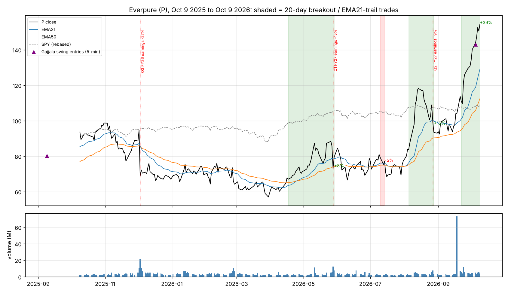
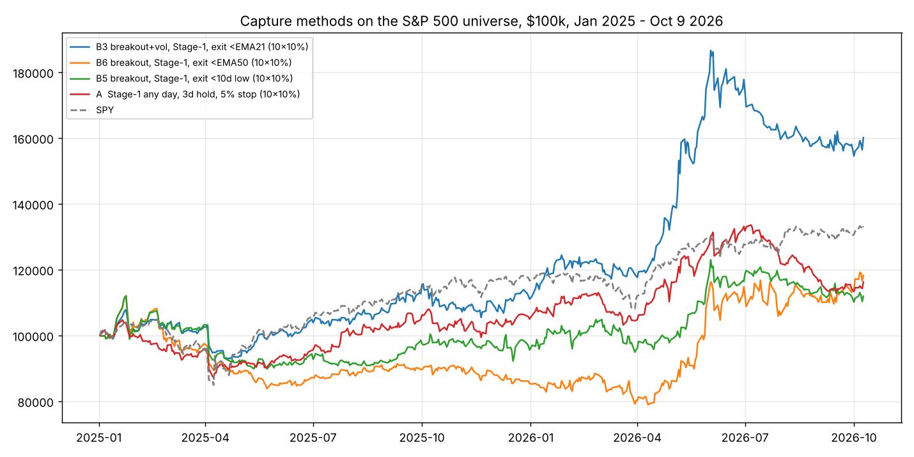

# Everpure (NYSE: P) — one-year deep dive and how to capture a stock like this

> **Superseded (Oct 13 2026):** the point-in-time constituent test in `VALIDATION_VERDICT.md` shows that about half of the edge reported here was survivorship bias from using today's S&P 500 list. Read that file first; the numbers below stand only as a record of the work.

Window: Oct 9 2025 to Oct 9 2026, 252 sessions. Data: Alpaca SIP daily and 5-minute bars.
P is the former Pure Storage (PSTG): renamed Everpure in February 2026, ticker changed to P on
April 17 2026. Enterprise flash storage, now selling itself as an AI-data-platform company.

## 1. What the stock did

| | |
|---|---|
| Close Oct 9 2025 → Oct 9 2026 | $93.62 → $154.49, **+65%** (SPY +16%) |
| 52-week low / high | $56.78 on Mar 30 2026 / $157.05 on Oct 8 2026 (+171% off the low) |
| Max drawdown inside the year | **-42%** (Nov 2025 → Mar 2026) |
| Annualised daily volatility | 69% |
| Average daily dollar volume | $320M |

It was not one move. It was two legs separated by three earnings reports, every one of which was sold:

| Phase | Dates | Move |
|---|---|---|
| Drift before Q3 FY26 earnings | Oct 9 → Dec 2 2025 | +1% |
| **Q3 FY26 earnings day** | Dec 3 2025 | **-27%** (gapped -17%, kept falling) |
| Base, new lows | Dec 3 → Mar 30 2026 | -17% |
| **Leg 1** | Mar 30 → May 27 | **+50%** |
| **Q1 FY27 earnings day** | May 28 | **-15%** (gapped -13%) despite a beat-and-raise |
| Consolidation, higher low | May 28 → Aug 10 | +34% |
| **Leg 2** (investor day, raised long-term targets, +38% revenue growth quarter) | Aug 11 → Oct 9 | **+58%** |
| Q2 FY27 earnings day | Aug 27 | -9% intraday, inside leg 2 |

Sources: [Investing.com Q4 FY26 transcript](https://www.investing.com/news/transcripts/earnings-call-transcript-pure-storage-q4-2026-beats-forecasts-with-strong-growth-93CH-4526187),
[Yahoo Q4 call highlights](https://finance.yahoo.com/news/pure-storage-q4-earnings-call-220540337.html),
[Investing.com: AI storage uncertainty overshadows breakneck growth](https://www.investing.com/analysis/everpure-ai-storage-uncertainty-overshadows-breakneck-growth-200681989),
[Motley Fool, Oct 9 2026](https://www.fool.com/investing/2026/10/09/top-storage-stock-to-buy-with-500-right-now/),
[Everpure 8-K on the name change](https://www.sec.gov/Archives/edgar/data/1474432/000147443226000011/pstg-20260223.htm),
[ticker change press release](https://www.nasdaq.com/press-release/everpure-change-ticker-symbol-p-2026-04-07),
[stockanalysis.com/P](https://stockanalysis.com/stocks/p/), [Simply Wall St](https://simplywall.st/stocks/us/tech/nyse-p/everpure).
Next earnings is listed for Nov 18 2026.

## 2. Where the return actually came from (this decides what can capture it)

Decomposing the year's +50% log return (= +65% simple):

- **Overnight gaps: +39.5%. Intraday open-to-close: +11.7%.** Four fifths of the move happened while
  the market was closed. Any strategy that is flat overnight is structurally blind to this stock.
- **The ten biggest days net to -6.9%.** The other 241 days add up to +56.9%. The return was a grind
  of ordinary up days (55% of days up, average +3.0% vs -3.3%), not a few jackpots. You cannot
  catch it with a trigger that fires on big days; you have to be in for the ordinary ones.
- **Trend days.** Inside leg 2 the stock closed above its EMA21 on 35 of 44 sessions with a worst
  pullback of -22% (the Aug 27 earnings day); inside leg 1, 32 of 41 with a worst pullback of -13%.
  A trailing exit on the EMA21 survives both legs.
- **Earnings.** Three reports, three red days, two of them gapping 13% to 17% through any stop.
  Both big crashes came with the stock above its EMA21 (in an uptrend). This is the one risk a trend
  position in this name cannot stop out of.

## 3. What the momentum scanners saw

| Lens | Result on P |
|---|---|
| Gajjala Stage 1 top 15 | On the list only 23 of 252 sessions. First window Aug 11 to 28 (**-15%**, it caught the top of the first spike before the Aug 27 earnings drop). Second window Sep 29 to Oct 9 (+19%). Rank 1 on 7 sessions. |
| Tuned swing strategy (5-min entry, 5% stop, 3-session hold) | **2 trades in P all year**, both winners: +0.5R and +1.1R, **$794** on $100k. The stock did +65%. |
| 20-day-high breakout (close > EMA50), exit on close < EMA21 | **4 trades, +66% compounded**, 24% time in the market, worst trade -4.7%: Apr 17→May 29 +8%, Jul 10→14 -5%, Aug 5→28 +16%, Sep 22→Oct 9 +39% (still open). |
| New 52-week-high close, exit on close < EMA21 | 3 trades, +4%: the 52-week-high entry arrives late (Aug 12, right before earnings) and once early in a failed move. |
| Buy and hold | +65% with a -42% drawdown and a -27% day in the middle. |

The ranker-based scanners find P after a vertical 21-day move, which is exactly when it is most
extended. The breakout rule found it on Apr 17 (leg 1 just under way), Aug 5 and Sep 22, each time
weeks before the ranker put it in the top 15. All methods are on `research/out/P_methodB_trades.csv`
and `research/out/p_deep_dive.log`.

## 4. Does the trend method generalise, or is it a P story?

Same daily rules across all 516 names, Jan 2025 to Oct 9 2026 (`research/capture_universe.py`):

| Method (entries next open, exits next open) | Trades | Win | Avg / trade | PF (IS / OOS) | Avg hold |
|---|---|---|---|---|---|
| 20d breakout + >EMA50, exit <EMA21, no filter | 4,462 | 35% | +0.74% | 1.27 (1.23 / 1.32) | 22 d |
| + Stage 1 filter (RS > SPY, >SMA50, $25M, within 10% of 52w high) | 2,637 | 37% | +0.96% | 1.36 (1.30 / 1.43) | 24 d |
| **+ breakout volume ≥ 1.5x 20d avg** | **1,271** | **39%** | **+1.20%** | **1.40 (1.35 / 1.46)** | 26 d |
| Stage 1 + breakout, exit <EMA50 | 2,063 | 35% | +2.42% | 1.73 (1.97 / 1.45) | 43 d |
| Stage 1 + breakout, exit <10-day low | 2,195 | 40% | +1.51% | 1.45 (1.47 / 1.43) | 37 d |
| Stage 1 any day, hold 3 d, 5% stop (swing, unranked) | 16,159 | 51% | +0.11% | 1.09 (1.04 / 1.15) | 4 d |

Per trade, trend holding beats short holds by an order of magnitude and improves out-of-sample.
But capital is finite, so the portfolio view with 10 slots of 10% is what matters
(`research/capture_portfolio.py`, 5 bps slippage):

| Portfolio, 10 slots × 10% | Final | Max DD | Sharpe | 2025 | 2026 |
|---|---|---|---|---|---|
| Trend: Stage 1 + breakout on volume, exit <EMA21 | **+60%** | -17% | 1.38 | +11% | +44% |
| Trend: exit <EMA50 (slots clog with long holds) | +18% | -30% | 0.52 | -15% | +39% |
| Swing: Stage 1 any day, 3 d, 5% stop (unranked) | +16% | -17% | 0.59 | +5% | +11% |
| Tuned swing (5-min entry, top-15 ranked, from REPORT.md) | +68% | **-5.6%** | 2.32 | +23% | +36% |
| SPY | +33% | -19% | | +17% | +14% |

Two different ways to the same ~+60-70%: the swing takes 415 small bites with a 5.6% drawdown; the
trend method takes 200 positions, loses 61% of them, and sits through a 17% drawdown to hold the
ones that run. On P specifically the trend method made +66% and the swing made under 1%.

## 5. How to capture a stock like P: the rules

1. **Hold overnight, and hold for weeks.** The return is in the gaps and the grind. Intraday rules
   cannot see it; 3-day rules skim ~1% off each push.
2. **Enter on the breakout, not on the rank.** Daily close above the 20-day high, above the EMA50,
   on ≥1.5x volume, in a name that already passes the Stage 1 trend filter. This fired on P on
   Apr 17, Aug 5 and Sep 22. The rank-1 flag came weeks later each time.
3. **Exit on the trend, not on a target.** Sell the next open after a daily close below the EMA21.
   No T1/T2/T3: a 1.5% target with a breakeven stop would have taken P's leg 2 off at +1.5% and then
   been stopped at entry (the RDT-ladder replay in `RDT_INTEGRATION.md` shows exactly this).
   The EMA21 trail gave back ~8% from the top on each exit and kept +66%.
4. **Respect earnings.** P fell on all three reports; two gapped through any stop. Rule for the
   trend book: if a report falls inside the hold, either exit at the close before it or cut to half,
   unless the position is already up more than 2x the stock's typical earnings move (P's is ~15%).
   The Aug 27 trade survived only because it was +25% going in.
5. **Size for a 35-40% win rate.** This is not the swing book. 10% of equity per slot, 10 slots,
   expect a 15-20% drawdown in a bad quarter, and expect most trades to be small losses.
6. **Run both books.** Swing (first push, low drawdown) and trend (the leg) are complementary;
   the swing's 3-day exit is often the trend book's entry week.

## 6. What this means for the RDT engine

A second exit profile, not a second scanner. Same Stage 1 list, same Alpaca daily bars:

- strategy `Momentum Trend Hold`: entry when the daily close > 20-day high and > EMA50 with volume
  ≥ 1.5x, on a Stage 1 name; fill next open (or at 09:45 if the open holds above the prior close).
- exit: next open after a daily close < EMA21; hard stop -8% as a disaster guard; earnings rule above.
- sizing: 10% of equity, max 10 slots, `disabled_strategies` kill-switch.
- improvement to test once live: when more signals than slots fire on one day, take them by 21-day RS
  rank rather than first-come (the simulation above filled slots alphabetically and still made +60%).

Not financial advice. One stock, one bull year, and a 21-month universe test.

## Files
- `research/p_deep_dive.py`, `research/out/p_deep_dive.log`: return decomposition, phases, capture methods on P
- `research/p_trades.py`, `research/out/p_trades.log`, `research/out/P_methodB_trades.csv`, `P_chart.png`
- `research/capture_universe.py`, `research/out/capture_universe.log`: universe-wide per-trade results
- `research/capture_portfolio.py`, `research/out/capture_portfolio.log`, `capture_curves.png`
- `research/out/P_daily_1y.csv`: the year of daily bars with indicators
