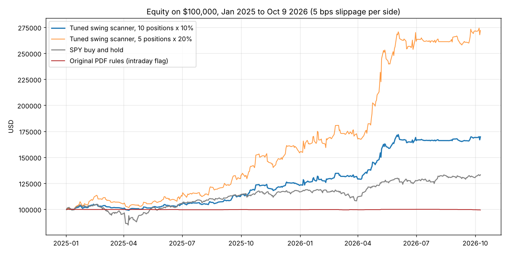

# Gajjala Momentum Scanner (US): what works, what doesn't, and the version to trade

> **Superseded (Oct 13 2026):** the point-in-time constituent test in `VALIDATION_VERDICT.md` shows that about half of the edge reported here was survivorship bias from using today's S&P 500 list. Read that file first; the numbers below stand only as a record of the work.


Research period: Jan 2, 2025 to Oct 9, 2026 (444 sessions). Data: Alpaca SIP, split-adjusted.
Universe: current S&P 500 constituents plus 13 Nasdaq-100 names outside the S&P 500 (516 symbols).
Account: $100,000. Slippage: 5 bps per side in the portfolio simulations. No commissions.
In-sample (IS) = 2025. Out-of-sample (OOS) = Jan to Oct 9, 2026. Every rule change was chosen on
2025 and then checked on 2026.

## 1. Bottom line

| Strategy | Trades | Win rate | Profit factor | Avg R | $100k becomes | Max drawdown |
|---|---|---|---|---|---|---|
| Original PDF rules (intraday bull flag) | 29 | 52% | 0.74 | -0.12 | $99,300 | -0.7% |
| Tuned swing version, 10 positions x 10% | 415 | 54% | 1.80 | +0.29 | $169,700 | -5.6% |
| Tuned swing version, 5 positions x 20% | 349 | 54% | 1.80 | +0.29 | $272,000 | -10.5% |
| SPY buy and hold | | | | | $133,200 | -19.0% |

The original intraday flag breakout does not work. Across 1,152 grid combinations, 36 one-at-a-time
variations and five families of exits and stops, no intraday version of it had a profit factor above
1.0 on the full period. The edge that does exist in the setup is at the daily timeframe: buying a
momentum leader on a strong, high-volume open and holding it three sessions.



## 2. The tuned strategy (what `gajjala_swing_scanner_us.py` does)

Stage 1, daily, as of the prior close (unchanged from the PDF, plus one filter):
- 21-day return beats SPY, close above 50-day SMA, price above $10, 20-day average dollar volume above $25M
- rank by 21-day return, keep the top 15
- **new:** only names within 10% of their 52-week high are eligible

Stage 2, 5-minute bars, regular hours:
- **entry:** first 5-minute close above the high of the first 15 minutes (bars 1 to 3), from 09:45 on
- volume on that bar at least 1.5x the 20-bar average
- close > EMA9 > EMA21 and close > session VWAP (kept from the PDF)
- SPY above its own session VWAP (kept from the PDF; this is the single most valuable filter)
- one entry per symbol per day, skip symbols already held

Exits:
- hard stop 5% below entry (GTC stop order)
- otherwise sell at the close of the 3rd session after entry
- no profit targets, no EMA9 trail: both reduced returns

Sizing: 10% of equity per position, max 10 open positions. At the 5% stop that is 0.5% of equity at
risk per trade, the same as the PDF.

## 3. How the original rules failed

Full-period replay of the PDF rules, every 5-minute bar evaluated, Stage 1 recomputed daily:
29 trades in 21 months, -3.5R, profit factor 0.74. The 1.5% six-bar pole is so rare on large caps
that the scanner is idle most days. Loosening it does not help, it just loses more often:

| Pole minimum | Trades | Profit factor | Total R |
|---|---|---|---|
| 1.5% (spec) | 29 | 0.74 | -3.5 |
| 1.0% | 132 | 0.94 | -3.1 |
| 0.75% | 263 | 0.88 | -14.0 |
| 0.5% | 547 | 0.89 | -26.4 |
| off | 1,924 | 0.95 | -39.8 |

One-at-a-time changes to every other rule (flag range, volume multiple, EMA stack, VWAP, SPY filter,
top-N, flag/pole bars, time of day, minimum risk, pole-low stop, ATR stops, EMA21 trail, no trail,
break-even trail, no targets, wider targets, requiring the 200 SMA, 52-week-high proximity) all stayed
below a profit factor of 1.0 on the full period (`research/out/sensitivity.csv`, `round2.log`).

The grid search found flag configurations with profit factors of 1.5 to 1.7 in 2025 (all overnight
holds with an EMA21 trail). Every one of the top 15 then lost in 2026, with OOS profit factors of
0.68 to 0.95 (`research/out/validation.csv`). That is what curve fitting looks like, and it is why the
chosen strategy was selected by its behaviour on both halves, not its 2025 score.

## 4. Why the swing version is believable

Robustness checks on the chosen configuration (`research/out/round5.log`):

- **Both halves positive.** IS profit factor 1.63, OOS 1.98. All eight quarters profitable.
- **Smooth parameter surface.** Every neighbouring value stayed profitable: 52-week-high proximity 5% to 20%
  (PF 1.6 to 1.9), stop 3% to 8% (1.4 to 1.8), hold 1 to 5 days (1.6 to 1.8), volume 1.0x to 2.5x
  (1.6 to 2.2), opening range 10 to 30 minutes (1.7 to 1.8), top-N 10 to 30 (1.4 to 2.0).
- **Beats the naive benchmark.** Buying every Stage 1 leader at 09:45 with no entry rule and the same
  exits earns an average of 0.07R per trade (PF 1.16). The entry filters lift that to 0.29R (PF 1.80).
  So the edge is not just "momentum stocks went up in 2025-26", though that is part of it.
- **Which filters matter.** Removing the SPY-above-VWAP filter drops PF from 1.80 to 1.56. Removing the
  EMA stack drops it to 1.65. Removing the VWAP condition changes nothing (1.82). The 52-week-high
  filter lifts PF from 1.50 to 1.80 and halves the drawdown.
- **Bootstrap.** 2,000 resamples of the trade list: median +120R, 5th percentile +75R, zero resamples
  ended negative, 95th-percentile max drawdown 15R (about 7.5% of equity at 10% sizing).
- **Loss profile.** 415 trades, 105 stopped, 294 held to the 3-day exit. Only 5 losses exceeded 1.5R
  (overnight gaps); the worst was -2.6R (APA, Apr 2026).

## 5. What to worry about

- **Concentration.** Five semiconductor and memory names (SNDK, MU, AMD, ARM, STX) made 55% of the
  profit, mostly in April and May 2026. Momentum strategies always ride the leading theme, but a
  theme-free period will look like Q3 2026: 26 trades, +3R, flat equity for four months.
- **Bull market only.** Jan 2025 to Oct 2026 contains one 19% SPY drawdown (April 2025, which the
  strategy sat out thanks to the SPY VWAP filter and the 52-week-high filter) but no bear market.
  Expect the stop to be hit far more often in a sustained downtrend.
- **Survivorship bias.** The universe is today's S&P 500 list. Names that were removed during the period
  are missing and names added late were included early. This flatters Stage 1 somewhat.
- **Fills.** Entries are at the 5-minute close that confirms the breakout; a live order fills on the
  next bar. The 5 bps slippage assumption is reasonable for these large caps but not guaranteed on the
  fast opens where most signals fire (half of all entries happen before 10:00).
- **Sample size.** 415 trades over 21 months is enough to say the original rules do not work and that this
  version has had an edge, not enough to size it aggressively. Paper trade it first.

## 6. Running it

```
pip install pandas numpy requests
export APCA_API_KEY_ID=...  APCA_API_SECRET_KEY=...     # or run behind a proxy that injects them
python trading/gajjala_swing_scanner_us.py                # every 5 minutes, 09:45 to 15:55 ET
python trading/gajjala_swing_scanner_us.py --manage       # at ~15:50 ET: positions due for the 3-day exit
python trading/gajjala_swing_scanner_us.py --date 2026-05-05   # replay a session
python trading/gajjala_swing_scanner_us.py --paper        # add to either mode to submit paper orders
```

Each scan prints the Stage 1 list, the check-by-check status of every eligible leader on the latest
bar, and any new signals with entry, stop, quantity and exit session. Signals append to
`us_swing_signals.csv`; open positions live in `swing_positions.json`. Paper order submission
(`--paper`) sends a market buy with an attached GTC stop and a market sell on the exit day; it was
written against the Alpaca orders API but has not yet been exercised against a live session.

## 7. Files

- `gajjala_swing_scanner_us.py`: the tuned live scanner (this report's strategy)
- `gajjala_scanner_us.py`: the original PDF rules, replay version
- `backtest.py`: simple backtester for the original rules (the September run)
- `research/data.py`: builds the data cache (daily + 5-min bars for every Stage 1 leader)
- `research/engine.py`: vectorized backtester, every rule is a parameter
- `research/run.py`, `round2.py` to `round5.py`, `portfolio.py`: the study, in the order it was run
- `research/out/*.log`, `*.csv`: every result quoted above, including full trade lists
  (`chosen_trades.csv`, `baseline_trades.csv`, `equity_curves.csv`)

Not financial advice.
